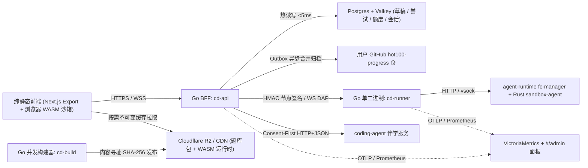

# `coding-dance` 后 Node.js 架构演进与现代化改造方案

> **分支**：`feat/go-modernization`（长期演进主线）  
> **状态**：设计定稿 & 分阶段工程落地中  
> **核心原则**：让 Node.js 彻底退回为**纯前端静态打包期工具（Next.js Static Export）**；云端运行面、BFF 控制面、并发题库构建器统一收敛至 **Go 单二进制矩阵（`cd-runner` / `cd-api` / `cd-build`）+ Rust `fc-manager` / `sandbox-agent`**，所有阶段支持零停机灰度切流与秒级回滚。

---

## 1. 现状诊断与演进动机

当前仓库中存在约 **5,400 行** Node.js / Python / CJS / MJS 混编服务端与工具链脚本（分布在 `tools/` 与 `site/functions/`）。随着 15 语言云端沙箱、交互式真调试器（DAP）和 Consent-First AI 伴学深入落地，旧架构暴露出四大结构性瓶颈：

| 痛点维度 | 现有实现 | 工程代价与风险 |
| --- | --- | --- |
| **1. 云端运行器控制面重复建设** | `tools/runner/server.mjs` + `lib/{sign,sandbox}.mjs` | 宿主机（如 `lou1`）必须额外部署维护 Node 24 运行时；不支持长连接 WebSocket DAP 真调试器会话转发；缺乏标准 OpenTelemetry 指标与 `#/admin` 联合监控。 |
| **2. 把 GitHub REST API 当实时 OLTP 数据库** | `site/functions/api/{progress,practice,sync,settings}` | 每次草稿自动保存或提交记录均串行执行 `GET tree` → `GET blob` → `POST tree` → `POST commit` → `PATCH ref`，高频触发 `409` SHA 乐观锁冲突、GitHub 二级限流，且三域名登录态被迫依赖 KV + 一次性票据重定向同步（`sso.ts`）。 |
| **3. 混编脚本构建链阻塞效率并污染 Git 历史** | `tools/illustrations/*.js`、`tools/practice/*.{cjs,py}` | 题面、标记或模板微调需串行启动大量 Node + Python 子进程，并将数百份派生 JSON（`data/`、`cases/`、`practice/data/`）提交入库，CI 强依赖 `git diff` 核对，极易制造合并冲突。 |
| **4. 运行时搬运与私有包阻塞 CI 闭环** | `tools/practice-runtime/prepare.mjs` + `@heroui-pro/react` | 构建期从 `node_modules` 硬拷贝 Pyodide/TypeScript 运行时，且 `@heroui-pro/react` 私有源授权使公开 GitHub Actions 无法直接执行 `next build` 与 Playwright 回归。 |

---

## 2. 目标架构全景与统一仓库布局

### 2.1 系统拓扑



### 2.2 Go 单模块目录规划

采用根级单一 `go.mod`（`CGO_ENABLED=0` 纯静态编译，零外部重依赖，离线与 CI 均可秒级构建）：

```text
coding-dance/
├── go.mod                                # 统一 Go 模块定义（零 CGO 依赖）
├── cmd/
│   ├── cd-runner/main.go                 # Phase 1：云端沙箱控制面与 WebSocket DAP 网关
│   ├── cd-api/main.go                    # Phase 2：Go BFF、热存储与异步 Git 归档守护进程
│   └── cd-build/main.go                  # Phase 3：并发题库校验、判题对拍与 R2 发布器
├── internal/
│   ├── conc/                             # 带并发上限的 errgroup 调度原语
│   ├── otel/                             # Prometheus 暴露、OTLP HTTP 推送与 #/admin 遥测快照
│   ├── ws/                               # RFC 6455 零依赖 WebSocket 服务端/客户端协议栈
│   ├── runner/                           # Phase 1：HMAC 验签、防重放、限流槽位、fc-manager/Docker/Local 驱动、DAP 会话桥
│   ├── progress/                         # Phase 2：100% 兼容 hot100-progress 的路径、frontmatter、codeKey 与单调状态机
│   ├── api/                              # Phase 2：AES-GCM 会话兼容层、Postgres/Valkey 热存储、异步 Git Outbox Worker、节点哈希路由、伴学代理
│   │   └── migrations/001_init.sql       # Postgres 生产表结构与索引契约
│   └── builder/                          # Phase 3：//@tag 行号提取、Mulberry32 用例生成、并发判题与 R2 内容寻址打包
└── contracts/
    └── schema/problem.schema.json        # Phase 3：声明式题目契约 JSON Schema
```

---

## 3. 四阶段演进详细设计

### Phase 1：Go 单二进制云端运行器 `cd-runner`（优先落地）

**核心目标**：100% 协议兼容替换 `tools/runner/server.mjs`，宿主机彻底移除 Node.js 运行时，原生打通交互式 WebSocket DAP 真调试器与 `#/admin` 可观测性。

1. **线协议与签名零改动兼容**
   - 保持 `X-Runner-{Time,Nonce,User,Node,Signature}` 规范化签名串：`METHOD\nPATH\nTIME\nNONCE\nUSER\nNODE\nSHA256_HEX(BODY)`，常量时间 HMAC-SHA256 校验，120 秒时钟偏移窗口 + `NonceCache` 防重放，拒绝跨节点重放。
   - 保持 `GET /healthz`、`GET /v1/status`（新增 `features: ["ts-transform", "dap-ws", "otel-metrics"]`）与 `POST /v1/run` 全部状态码（`200/400/401/413/429/502/503`）和中文错误文案一致。
2. **复用 `agent-runtime` 执行底座**
   - `FirecrackerDriver` 直连本机 `fc-manager`（`127.0.0.1:8097`）：每次执行或调试独占一台无网卡 microVM（`/v1/envs` → `/v1/envs/<id>/agent/v1/exec` → `DELETE /v1/envs/<id>`）。
   - 支持从 `/etc/agentruntime/fc-manager-secrets.json`（`_platform` 作用域下 `sandbox/fc-manager-token`）每次按需热读令牌，轮换密钥无需重启 `cd-runner`。
   - 保留 `DockerPool`（开发与 CI 预热池）与 `LocalDriver`（本机快速联调）。
3. **原生 WebSocket DAP 真调试器转发（`GET /v1/dap`）**
   - 浏览器 / `cd-api` 发起带签名的 WebSocket 升级请求（支持 Header 签名或 URL 查询参数签名）。
   - 首帧接收初始化配置 `{ lang: "go" | "cpp" | "java", mode, code, sig?, stdin? }`，在隔离沙箱内编译带调试符号的目标程序并拉起对应原声 DAP 适配器（`dlv dap`、`lldb-dap` / `gdb -i=dap`、`java-debug`）。
   - 内置双向帧协议转换器：WebSocket UTF-8 JSON 消息 ⇄ 标准 DAP `Content-Length: <N>\r\n\r\n<JSON>` 字节流。
   - 会话治理：每用户独占实例、空闲超时自动回收（默认 5 分钟 `RUNNER_DAP_IDLE_MS`）与单次总时长硬上限（`RUNNER_DAP_MAX_MS`），断开连接时确保销毁容器 / microVM。
4. **OpenTelemetry 与 `#/admin` 接入**
   - 采集任务计数、语言分布、编译错误率、队列等待耗时、microVM 启动耗时、槽位水位与活跃 DAP 会话数。
   - 提供 `GET /metrics`（Prometheus 标准文本格式）、签名保护的 `GET /v1/admin/telemetry`（供 `#/admin` 面板聚合展示），以及后台周期推送至 `OTEL_EXPORTER_OTLP_ENDPOINT`。
5. **宿主机零 Node.js 部署**
   - `tools/runner/deploy/setup.sh` 改为编译/安装静态二进制 `/usr/local/bin/cd-runner`，`lc-runner.service` 直接以低权限 `lc-runner` 系统用户启动 `/usr/local/bin/cd-runner`。

---

### Phase 2：Go BFF `cd-api` + Postgres/Valkey 热存储 + 异步 Git 双写

**核心目标**：消除把 GitHub REST API 当实时数据库导致的延迟抖动、`409` SHA 乐观锁冲突、二级限流与三域名 SSO 复杂度，同时坚守“用户完整拥有 `hot100-progress` Git 仓库”的产品承诺。

1. **会话无缝继承与统一 BFF 域名**
   - `internal/api/session.go` 实现与 `site/functions/_lib/session.ts` 位级兼容的 AES-256-GCM 加解密（`SHA-256(SESSION_SECRET)` 派生密钥，`iv.ciphertext` Base64URL 编码），线上平滑承接已有 `hot100_session` Cookie。
   - 支持统一 API 域名（如 `api.codingdance.cn`）配合 `SITE_ORIGINS` CORS 白名单（`leetcode.cgent.link`、`codexdance.cn`、`codingdance.cn`）与 `Origin` 同源/白名单校验，使三个前端域名共享同一套 BFF 会话，彻底淘汰跨域名一次性票据跳转链。
2. **Postgres 热存储 + Valkey 原子计数**
   - **写入热路径（`<5ms`）**：
     - `POST /api/progress/practice`（`draft` / `run` / `solution`）、`PUT /api/progress`、`PUT /api/settings` 直接在单事务内落库 Postgres（`practice_drafts`、`practice_attempts`、`user_solutions`、`problem_progress`、`user_settings`）并写入 `git_sync_outbox` 事务发件箱，立即向前端返回成功。
     - `GET /api/progress` 与 `GET /api/progress/practice` 优先命中热存储，冷启动未同步用户自动按需回源 GitHub 并回填热表。
   - **Valkey 原子额度与限流**：
     - 每日云端额度键 `quota:day:<YYYY-MM-DD>:<login>` 采用原子扣减 + 北京时间次日 `00:00:00+08:00` 过期（免费档 30 次/天 + 注册满 30 天校验 + `CLOUD_FREE_PAUSED` 预算开关；专业档/首批用户 2000 次/天；运行器 5xx/全忙自动原子退回额度）。
     - 内置进程内存兜底适配器，本机开发与单测无需外部中间件即可闭环运行。
3. **异步批量 Git 归档 Worker（`GitSyncWorker`）**
   - 按用户仓库维度聚合 `git_sync_outbox` 中待同步事件：
     - **草稿去抖合并**：同一题、同一语言、同一模式的多次 `Ctrl+S` / 60s 自动保存自动折叠为最新一份 `drafts/<lang>/<pad4>.<name>[.ACM].<ext>`。
     - **严格遵守进度仓规范**：复用 `internal/progress` 生成与 `record.ts` / `check.mjs` 完全一致的尝试记录 Markdown（`---` YAML 头 + 自适应反引号围栏）、`codeKey` 去重后的题解路径（`.2` / `.ACM` / `.未通过`）与按题号升序排列的 `progress.json`（状态只升不降）。
     - **批量单次 Commit**：计算 Git Blob SHA-1（`blob <len>\0<content>`）跳过未变更文件，通过单次 `POST /git/trees` → `POST /git/commits` → `PATCH /git/refs/heads/<branch>` 批量提交；若遇外部 push 导致 `409/422` 或 GitHub 限流，自动指数退避重算基线树并重试，前端零感知。
4. **集群调度与 Consent-First 伴学网关**
   - 内置加权最高随机权重哈希（Weighted Rendezvous Hashing，与 `runner.ts` 同构 FNV-1a 打分）将同一用户的 `/api/run` 与 `/api/dap` 稳定路由至同一 `cd-runner` 节点，节点满载/离线自动故障转移。
   - 原样保留 `/api/companion/{status,hint-check,hint-reveal,history-analyze}` 契约，强校验 `consent_mode !== "off"` 与 `user_consented === true` 后转发至 `coding-agent`。

---

### Phase 3：声明式题库契约与 Go 并发构建器 `cd-build`（已完成）

**核心目标**：用纯 Go 并发工具链彻底替代串行混编脚本链（`tools/practice/build.cjs`、`official-examples.py`、`descriptions.cjs`、`boundaries.cjs`、`tools/illustrations/judge/run.js`），秒级完成全量标记核对、六语言判题、纯 Go 100 题练习数据生成与内容寻址 R2 构建物打包，并从 Git 彻底清理 375 份派生 JSON 污染。

1. **声明式题库契约（`contracts/practice-meta.json` + `contracts/schema/problem.schema.json`）**
   - 将题面叙述（`descriptions`）与手写边界用例（`boundaries`）沉淀为声明式 JSON 契约 `contracts/practice-meta.json`，与题号、标题、难度、专题、函数签名 `sig`、分层提示 `hints`、易错点 `points`、预设输入 `presets` 一并由 `cd-build export-contracts` 并发导出。
2. **`cd-build` 并发流水线（基于 `internal/conc.Group`）**
   - `build`：多路分片并发运行图解导出（`--no-topic-index`）并由 Go 统一汇总 `topics/index.json`（校验 `site/lib/topic-slugs.ts`），随后并发执行纯 Go 100 题练习生成器（`internal/builder/practice_gen.go`、`starters.go`、`examples.go`、`acm_codec.go`：生成 15 语言起始模板、248 组官方示例、1598 组测试用例及两代草稿迁移哈希），可选 `--bundle site/public/_r2` 一站生成内容寻址资源包。
   - `verify`：并发扫描全部 100 道热题与 22 个基础专题，提取 `#@tag` / `//@tag` 行号映射表，严格校验多语言步骤标记集合与 Python 标准代码 100% 一致，校验官方示例、预设与判题用例完整性。
   - `judge`：按 CPU 核心数并发调度多语言工具链（`python3`、`go`、`node`、`tsc --strict`、`javac`/`java`、`g++`）编译运行全部题解并与基准用例对拍。
   - `bundle`：生成确定性内容寻址产物包（`v1/problems/<id>.<sha256[:12]>.json`、`v1/practice/<id>.<sha256[:12]>.json`、`v1/topics/<slug>.<sha256[:12]>.json`、`v1/manifest.json`），支持 SigV4 R2 增量同步，边缘路由 `site/functions/_lib/r2.ts` 按 `R2_ASSETS_BASE_URL` → `env.ASSETS` (`/_r2/...`) → GitHub Raw 三级顺序无感切换，Git 仓库已全面忽略并停止跟踪 `tools/illustrations/{data,cases}` 与 `tools/practice/data`。

---

### Phase 4：前端与 CI 纯粹化（零私有源闭环）（已完成）

**核心目标**：移除构建期 `node_modules` 文件搬运，解耦 `@heroui-pro/react` 私有 npm 授权依赖，使公开 GitHub Actions 无需任何私有源 Token 即可完成全量前端构建与浏览器 UI 端到端回归。

1. **WASM 语言运行时版本化清单与 R2 分发**
   - `site/public/practice-runtime/manifest.json` 统一声明 `pyodide`、`typescript`（含逐文件精确字节数与 SHA-256 摘要 `integrity`）及规划中的 `clang-wasm`、`go-wasm`、`teavm-javac` 元数据。
   - `site/lib/practice/runtime-manifest.ts` + `site/next.config.mjs` + `site/lib/practice/runner.ts` 集中从清单与 `NEXT_PUBLIC_RUNTIME_BASE_URL` 解析版本化运行时地址；`tools/practice-runtime/prepare.mjs` 支持 `--verify` SHA-256 校验、`--out <dir>` R2 导出与幂等缓存，已从 `npm run build` 阻塞链剥离。
2. **HeroUI Pro 预编译样式工件、开源兼容层与无头浏览器 CI**
   - 移除 `site/package.json` 对私有 `@heroui-pro/react` 的直接依赖，保留 `site/styles/heroui-pro.prebuilt.css`（`@layer components`）与 `site/lib/ui/heroui-pro-shim/`（支持受控/非受控与 WAI-ARIA 键盘漫游导航的 `Segment`、`EmptyState`、`KPIGroup` 及基于 `shiki` + SVG 图标的 `CodeBlock`）。
   - `.github/workflows/verify.yml` 全量移除 `/tmp/rt` 变通与 `HEROUI_PRO_SHIM=1` 强切，纯 `npm install --no-audit --no-fund && npm run build` 即可完成静态导出，并新增跨平台 Playwright `practice-ui` 真浏览器端到端回归任务。

---

## 4. 低风险灰度切流与回滚矩阵

| 演进阶段 | 当前状态 | 切流开关 / 灰度粒度 | 验证门禁 | 秒级回滚手段 |
| --- | --- | --- | --- | --- |
| **Phase 1 (`cd-runner`)** | **✅ 已完成落地（`server.mjs` 与 `lib/*` 已彻底退役）** | 按节点灰度：先新起 `lou2` 跑 `cd-runner`（或更新 `lou1`），`RUNNER_NODES` 平滑承接 | HMAC 签名测试向量一致、`fc-manager` 协议与 SecretStore 热读全绿、Java/Go/C++ WebSocket DAP 断点单步跑通、`/api/admin/runner` 指标可见 | 从 `RUNNER_NODES` 摘除异常节点或切回上一版静态二进制 |
| **Phase 2 (`cd-api`)** | **✅ 已完成落地（直连 GitHub 的 OLTP Pages Functions 与 `sso.ts` 已退役，统一收敛至 `cd-api` + Postgres/Valkey 热存储 + Edge BFF 代理）** | 前端 `NEXT_PUBLIC_API_BASE_URL` 或 Cloudflare `CD_API_UPSTREAM` 一键切流至 `cd-api` | AES-GCM Cookie 双向互通、Postgres 热写 `<5ms`、冷启动 GitHub Hydrator、Outbox Worker 批量合并提交及 Edge ⇄ Go OAuth 端到端全绿 | 清空 `CD_API_UPSTREAM` 退回只读降级态（Git 进度仓持续双写归档，数据零丢失） |
| **Phase 3 (`cd-build`)** | **✅ 已完成落地（375 份派生 JSON 已从 Git 退役，`build` / `judge` / `verify` / `bundle` 全部 Go 化）** | 边缘路由 `site/functions/_lib/r2.ts`：`R2_ASSETS_BASE_URL` → `env.ASSETS` (`/_r2/...`) → GitHub Raw 三级开关 | 100 题 + 22 专题 `//@tag` 零偏差、6 语言并发判题全绿、`r2.test.ts` 三级回退与 `out/_r2/v1/manifest.json` 通过 | 站点数据读取层按 3 级链自动平滑回退至静态资产或 GitHub Raw |
| **Phase 4 (前端 & CI)** | **✅ 已完成落地（`@heroui-pro/react` 私有依赖解耦、`manifest.json` SHA-256 校验、Playwright CI 接入）** | `NEXT_PUBLIC_RUNTIME_BASE_URL` 控制 R2 运行时源（不设时自动回退本地 `/practice-runtime/vendor/`） | 零私有 Token `npm install && npm run build` 成功、WASM 清单 SHA-256 单测与 `practice-ui` 端到端回归全绿 | 清空 `NEXT_PUBLIC_RUNTIME_BASE_URL` 即退回同源静态目录 |
