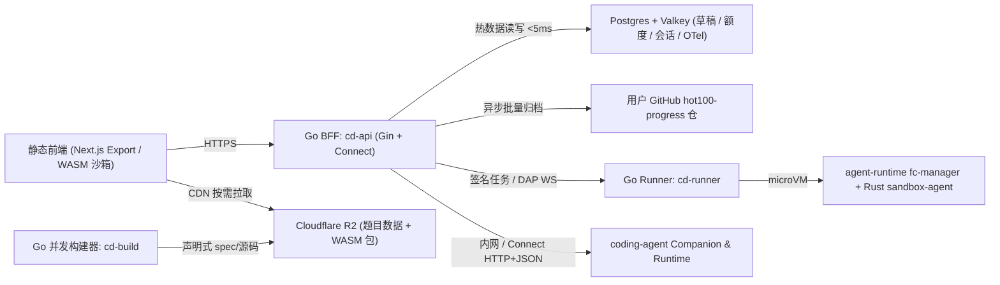

# `coding-dance` 后 Node.js 架构演进与现代化改造方案

> 状态：架构蓝图（配合 `Wave 3` 伴学接入落地编写，用于指导下一阶段基础设施重构）。

---

## 1. 现状诊断：为什么不能一直依赖 Node.js 全栈粘合

当前 `coding-dance` 仓库中约有 **5,385 行** 工具链与服务端胶水代码（见 `tools/`）以及运行在 Cloudflare Pages Functions 上的动态接口（`site/functions/`），随着在线编译、云端调试（DAP）和 AI 伴学接入深入，继续完全依托 Node.js 已暴露出四类结构性瓶颈：

| 痛点维度 | 现有实现 | 核心问题与工程代价 |
| --- | --- | --- |
| **1. 云端运行器控制面重复造轮** | `tools/runner/server.mjs`（Node Http + 队列/限流 + 调用 `fc-manager`） | 与 `agent-runtime` 已沉淀的 Go 服务与 Rust `sandbox-agent` 存在重复建设；宿主机仍需维护 Node.js 运行时，且缺乏标准 OpenTelemetry 指标与 `#/admin` 联合监控。 |
| **2. 把 GitHub REST API 当实时数据库** | `site/functions/api/{progress,practice,sync}` 直接调 `gh(...)` 读写 `hot100-progress` | 每次写尝试记录都要先 `listFiles` + `GET HEAD` 再串行建 blob/tree/commit，频繁触发 `409` SHA 乐观锁冲突、GitHub 二级限流，以及多域名登录态 KV + redirect SSO 复杂度。 |
| **3. 庞大的脚本构建链污染 Git 历史** | `tools/{illustrations,practice}/*.{js,cjs,mjs,py}`（425 行 `build.js`、251 行 `build.cjs`、588 行 `random.js`） | 任何题面、判题模板或用例微调都要本机重跑 Node+Python 脚本并提交海量生成的 JSON；CI 需要复跑比对 `git diff`，极易因版本差异产生合并冲突。 |
| **4. 私有依赖与运行时搬运阻塞 CI** | `tools/practice-runtime/prepare.mjs` 复制 `node_modules` 与 `@heroui-pro/react` | UI 回归与静态构建强依赖本机私有包与大量静态文件拷贝，GitHub Actions 难以闭环运行。 |

---

## 2. 目标架构：Go 控制面 + Rust/Firecracker 执行面 + 纯静态前端

将 Node.js 退回为“**纯前端构建期打包工具**”，后端控制面与数据管道统一收敛到 `Go + Rust`，并通过内网直接复用 `agent-runtime` 与 `coding-agent` 的多租户、SecretStore 与 OTel 底座：

---

## 3. 分阶段演进路线（4 阶段低风险切换）

| 阶段 | 改造范围与核心交付 | 替代的旧模块 | 预期收益与风险控制 |
| --- | --- | --- | --- |
| **Phase 1：Go 单二进制云端运行器** *(优先级最高)* | 用 Go 编写单一静态二进制 `cd-runner`，直接接入 `agent-runtime` 同一套 `fc-manager` HTTP/Unix API、UserLimits/Slots 并发控制与 `OTEL_EXPORTER_OTLP_ENDPOINT`，并原生支持 WebSocket 转发 **DAP（`dlv` / `lldb-dap` / `jdtls`）**。 | `tools/runner/server.mjs` 及 `tools/runner/lib/*` | 工作负载 **0 Node.js 依赖**，宿主机只部署一个静态二进制；DAP 长连接稳定性与并发队列延迟可控。 |
| **Phase 2：Go BFF + Postgres 热存储 + 异步 Git 双写** | 用 Go BFF `cd-api` 承接 `/api/progress/*`、`/api/settings`、`/api/run` 与 `/api/companion/*`。草稿、提交记录、额度先实时写入 Postgres/Valkey，由后台 Go Worker **异步批量 commit** 回用户自己的 `hot100-progress` 仓库。 | `site/functions/api/*` 与 `_lib/{progress,quota,session,companion}.ts` | 彻底消灭 `409` SHA 冲突与 GitHub 限流卡顿；与 `coding-agent` 可共享 OTel、VictoriaMetrics 与 `#/admin` 面板，且保留“用户完整拥有 Git 进度仓”的产品承诺。 |
| **Phase 3：声明式题库规范与 Go 并发构建器 `cd-build`** | 将 `tools/illustrations/specs/*.js` 中的元信息拆为声明式 JSON/YAML 契约，保留 Python/Go/Java/C++ 标准源码文件；用 Go + `errgroup` 并发完成 `//@tag` 行号提取、测试用例生成与多语言编译对拍，产物直接上传 R2 版本化路径。 | `tools/illustrations/*.js`、`tools/practice/*.cjs` | 构建耗时由分钟级降至数秒级；Git 仓库不再提交大批量派生 JSON，彻底消除 `git diff` 冲突。 |
| **Phase 4：前端纯粹化与零私有源 CI** | TypeScript 仅用于浏览器 UI 与编辑器；Pyodide/Clang/Go WASM 包全部托管于 R2 内容寻址目录（替代 `prepare.mjs` 搬运 `node_modules`），HeroUI Pro 样式提取预编译 CSS 工件入库。 | `tools/practice-runtime/prepare.mjs` | GitHub Actions 无需私有 npm Token 即可全量构建与运行 Playwright 回归。 |

---

## 4. 下一步工程落地建议

1. **先保留现有 `site/functions/api/companion/*` 契约不动**：`coding-agent` 已经以标准 HTTP+JSON 接口（`/api/integrations/coding-dance/v1/*`）解耦，将来从 Cloudflare Pages Functions 切换到 Phase 2 的 Go BFF（`cd-api`）时，前端（`site/lib/companion.ts`）零改动即可平滑迁移。
2. **优先立项 Phase 1（`cd-runner`）**：这是目前唯一还在云端长期驻留 Node.js 进程的组件，且与 `ROADMAP.md` 阶段 5「云端真调试器 DAP WebSocket」强耦合——用 Go 重写后即可一次打通 `fc-manager` 与 DAP 转发。
