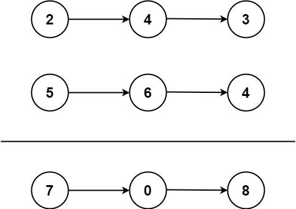

# 2. 两数相加

| 难度 | 专题 | 状态 | 优先级 | 力扣 |
| --- | --- | --- | --- | --- |
| 中等 | 链表 | 🔄 曾通过 | 复习 | [原题链接](https://leetcode.cn/problems/add-two-numbers) |

## 题目描述

给你两个&nbsp;<strong>非空</strong> 的链表，表示两个非负的整数。它们每位数字都是按照&nbsp;<strong>逆序</strong>&nbsp;的方式存储的，并且每个节点只能存储&nbsp;<strong>一位</strong>&nbsp;数字。

请你将两个数相加，并以相同形式返回一个表示和的链表。

你可以假设除了数字 0 之外，这两个数都不会以 0&nbsp;开头。

&nbsp;

<strong class="example">示例 1：</strong>

<pre>
<strong>输入：</strong>l1 = [2,4,3], l2 = [5,6,4]
<strong>输出：</strong>[7,0,8]
<strong>解释：</strong>342 + 465 = 807.
</pre>

<strong class="example">示例 2：</strong>

<pre>
<strong>输入：</strong>l1 = [0], l2 = [0]
<strong>输出：</strong>[0]
</pre>

<strong class="example">示例 3：</strong>

<pre>
<strong>输入：</strong>l1 = [9,9,9,9,9,9,9], l2 = [9,9,9,9]
<strong>输出：</strong>[8,9,9,9,0,0,0,1]
</pre>

&nbsp;

<strong>提示：</strong>

<ul>
	<li>每个链表中的节点数在范围 <code>[1, 100]</code> 内</li>
	<li><code>0 &lt;= Node.val &lt;= 9</code></li>
	<li>题目数据保证列表表示的数字不含前导零</li>
</ul>

## 本地题解

暂无本地题解。

## 思路图解

- 本地：[0002.两数相加.html](<../illustrations/0002.两数相加.html>)（下载后用浏览器打开）
- 在线：https://claude.ai/artifact/XpHFMwWC9vGB4m4rA9Ejzj
