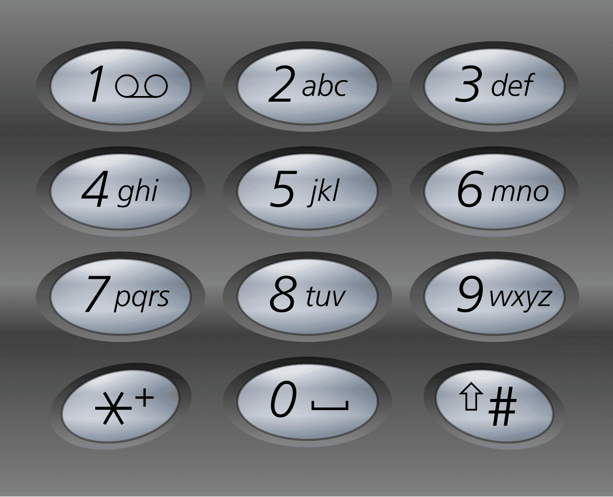

# 17. 电话号码的字母组合

| 难度 | 专题 | 状态 | 优先级 | 力扣 |
| --- | --- | --- | --- | --- |
| 中等 | 回溯 | 🔄 曾通过 | 复习 | [原题链接](https://leetcode.cn/problems/letter-combinations-of-a-phone-number) |

## 题目描述

给定一个仅包含数字&nbsp;<code>2-9</code>&nbsp;的字符串，返回所有它能表示的字母组合。答案可以按 <strong>任意顺序</strong> 返回。

给出数字到字母的映射如下（与电话按键相同）。注意 1 不对应任何字母。

&nbsp;

<strong>示例 1：</strong>

<pre>
<strong>输入：</strong>digits = "23"
<strong>输出：</strong>["ad","ae","af","bd","be","bf","cd","ce","cf"]
</pre>

<strong>示例 2：</strong>

<pre>
<strong>输入：</strong>digits = "2"
<strong>输出：</strong>["a","b","c"]
</pre>

&nbsp;

<strong>提示：</strong>

<ul>
	<li><code>1 &lt;= digits.length &lt;= 4</code></li>
	<li><code>digits[i]</code> 是范围 <code>['2', '9']</code> 的一个数字。</li>
</ul>

## 本地题解

暂无本地题解。

## 思路图解

- 本地：[0017.电话号码的字母组合.html](<../illustrations/0017.电话号码的字母组合.html>)（下载后用浏览器打开）
- 在线：https://claude.ai/artifact/Wvdm2qCzFbWjc5LdkoQ6Vk
