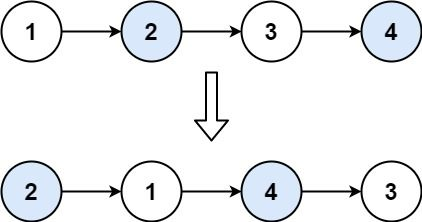

# 24. 两两交换链表中的节点

| 难度 | 专题 | 状态 | 优先级 | 力扣 |
| --- | --- | --- | --- | --- |
| 中等 | 链表 | 🔄 曾通过 | 复习 | [原题链接](https://leetcode.cn/problems/swap-nodes-in-pairs) |

## 题目描述

给你一个链表，两两交换其中相邻的节点，并返回交换后链表的头节点。你必须在不修改节点内部的值的情况下完成本题（即，只能进行节点交换）。

&nbsp;

<strong>示例 1：</strong>

<pre>
<strong>输入：</strong>head = [1,2,3,4]
<strong>输出：</strong>[2,1,4,3]
</pre>

<strong>示例 2：</strong>

<pre>
<strong>输入：</strong>head = []
<strong>输出：</strong>[]
</pre>

<strong>示例 3：</strong>

<pre>
<strong>输入：</strong>head = [1]
<strong>输出：</strong>[1]
</pre>

&nbsp;

<strong>提示：</strong>

<ul>
	<li>链表中节点的数目在范围 <code>[0, 100]</code> 内</li>
	<li><code>0 &lt;= Node.val &lt;= 100</code></li>
</ul>

## 本地题解

- Java：[0024.两两交换链表中的节点.java](<../solutions/java/0024.两两交换链表中的节点.java>)

## 思路图解

- 本地：[0024.两两交换链表中的节点.html](<../illustrations/0024.两两交换链表中的节点.html>)（下载后用浏览器打开）
- 在线：https://claude.ai/artifact/4hApNs6m9jq9xi3FpigHH1
- 网站：https://leetcode.cgent.link/p/24/（提示、动画演示、题解和我的提交都在一页）
