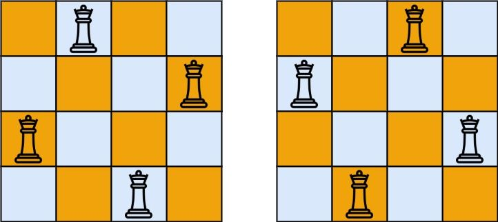

# 51. N 皇后

| 难度 | 专题 | 状态 | 优先级 | 力扣 |
| --- | --- | --- | --- | --- |
| 困难 | 回溯 | ⬜ 未开始 | 已通过 | [原题链接](https://leetcode.cn/problems/n-queens) |

## 题目描述

按照国际象棋的规则，皇后可以攻击与之处在同一行或同一列或同一斜线上的棋子。

<strong>n&nbsp;皇后问题</strong> 研究的是如何将 <code>n</code>&nbsp;个皇后放置在 <code>n×n</code> 的棋盘上，并且使皇后彼此之间不能相互攻击。

给你一个整数 <code>n</code> ，返回所有不同的&nbsp;<strong>n<em>&nbsp;</em>皇后问题</strong> 的解决方案。

每一种解法包含一个不同的&nbsp;<strong>n 皇后问题</strong> 的棋子放置方案，该方案中 <code>'Q'</code> 和 <code>'.'</code> 分别代表了皇后和空位。

&nbsp;

<strong>示例 1：</strong>

<pre>
<strong>输入：</strong>n = 4
<strong>输出：</strong>[[".Q..","...Q","Q...","..Q."],["..Q.","Q...","...Q",".Q.."]]
<strong>解释：</strong>如上图所示，4 皇后问题存在两个不同的解法。
</pre>

<strong>示例 2：</strong>

<pre>
<strong>输入：</strong>n = 1
<strong>输出：</strong>[["Q"]]
</pre>

&nbsp;

<strong>提示：</strong>

<ul>
	<li><code>1 &lt;= n &lt;= 9</code></li>
</ul>

## 本地题解

暂无本地题解。

## 思路图解

- 本地：[0051.N 皇后.html](<../illustrations/0051.N 皇后.html>)（下载后用浏览器打开）
- 网站：https://leetcode.cgent.link/p/51/（提示、动画演示、题解和我的提交都在一页）
