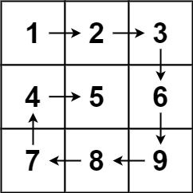
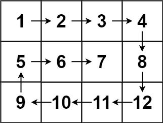

# 54. 螺旋矩阵

| 难度 | 专题 | 状态 | 优先级 | 力扣 |
| --- | --- | --- | --- | --- |
| 中等 | 矩阵 | ✅ 已通过 | 已通过 | [原题链接](https://leetcode.cn/problems/spiral-matrix) |

## 题目描述

给你一个 <code>m</code> 行 <code>n</code> 列的矩阵 <code>matrix</code> ，请按照 <strong>顺时针螺旋顺序</strong> ，返回矩阵中的所有元素。

 

<strong>示例 1：</strong>

<pre>
<strong>输入：</strong>matrix = [[1,2,3],[4,5,6],[7,8,9]]
<strong>输出：</strong>[1,2,3,6,9,8,7,4,5]
</pre>

<strong>示例 2：</strong>

<pre>
<strong>输入：</strong>matrix = [[1,2,3,4],[5,6,7,8],[9,10,11,12]]
<strong>输出：</strong>[1,2,3,4,8,12,11,10,9,5,6,7]
</pre>

 

<strong>提示：</strong>

<ul>
	<li><code>m == matrix.length</code></li>
	<li><code>n == matrix[i].length</code></li>
	<li><code>1 <= m, n <= 10</code></li>
	<li><code>-100 <= matrix[i][j] <= 100</code></li>
</ul>

## 本地题解

- Java：[0054.螺旋矩阵.java](<../solutions/java/0054.螺旋矩阵.java>)

## 思路图解

- 本地：[0054.螺旋矩阵.html](<../illustrations/0054.螺旋矩阵.html>)（下载后用浏览器打开）
- 在线：https://claude.ai/artifact/4Sjrt4vptYag2FEVmLSHZg
- 网站：https://leetcode.cgent.link/p/54/（提示、动画演示、题解和我的提交都在一页）
