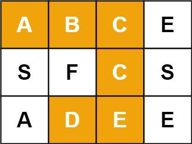
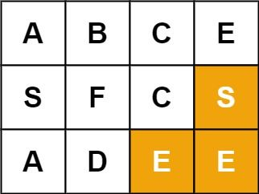
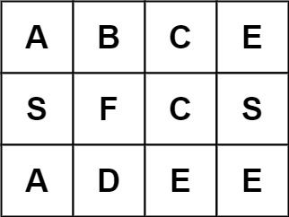

# 79. 单词搜索

| 难度 | 专题 | 状态 | 优先级 | 力扣 |
| --- | --- | --- | --- | --- |
| 中等 | 回溯 | ⬜ 未开始 | P1 | [原题链接](https://leetcode.cn/problems/word-search) |

## 题目描述

给定一个&nbsp;<code>m x n</code> 二维字符网格&nbsp;<code>board</code> 和一个字符串单词&nbsp;<code>word</code> 。如果&nbsp;<code>word</code> 存在于网格中，返回 <code>true</code> ；否则，返回 <code>false</code> 。

单词必须按照字母顺序，通过相邻的单元格内的字母构成，其中“相邻”单元格是那些水平相邻或垂直相邻的单元格。同一个单元格内的字母不允许被重复使用。

&nbsp;

<strong>示例 1：</strong>

<pre>
<strong>输入：</strong>board = [['A','B','C','E'],['S','F','C','S'],['A','D','E','E']], word = "ABCCED"
<strong>输出：</strong>true
</pre>

<strong>示例 2：</strong>

<pre>
<strong>输入：</strong>board = [['A','B','C','E'],['S','F','C','S'],['A','D','E','E']], word = "SEE"
<strong>输出：</strong>true
</pre>

<strong>示例 3：</strong>

<pre>
<strong>输入：</strong>board = [['A','B','C','E'],['S','F','C','S'],['A','D','E','E']], word = "ABCB"
<strong>输出：</strong>false
</pre>

&nbsp;

<strong>提示：</strong>

<ul>
	<li><code>m == board.length</code></li>
	<li><code>n = board[i].length</code></li>
	<li><code>1 &lt;= m, n &lt;= 6</code></li>
	<li><code>1 &lt;= word.length &lt;= 15</code></li>
	<li><code>board</code> 和 <code>word</code> 仅由大小写英文字母组成</li>
</ul>

&nbsp;

<strong>进阶：</strong>你可以使用搜索剪枝的技术来优化解决方案，使其在 <code>board</code> 更大的情况下可以更快解决问题？

## 本地题解

暂无本地题解。

## 思路图解

- 本地：[0079.单词搜索.html](<../illustrations/0079.单词搜索.html>)（下载后用浏览器打开）
- 网站：https://leetcode.cgent.link/p/79/（提示、动画演示、题解和我的提交都在一页）
