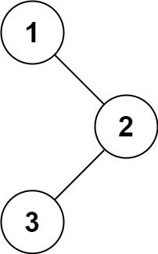

# 94. 二叉树的中序遍历

| 难度 | 专题 | 状态 | 优先级 | 力扣 |
| --- | --- | --- | --- | --- |
| 简单 | 二叉树 | ✅ 已通过 | 已通过 | [原题链接](https://leetcode.cn/problems/binary-tree-inorder-traversal) |

## 题目描述

给定一个二叉树的根节点 <code>root</code> ，返回 <em>它的 <strong>中序</strong>&nbsp;遍历</em> 。

&nbsp;

<strong>示例 1：</strong>

<pre>
<strong>输入：</strong>root = [1,null,2,3]
<strong>输出：</strong>[1,3,2]
</pre>

<strong>示例 2：</strong>

<pre>
<strong>输入：</strong>root = []
<strong>输出：</strong>[]
</pre>

<strong>示例 3：</strong>

<pre>
<strong>输入：</strong>root = [1]
<strong>输出：</strong>[1]
</pre>

&nbsp;

<strong>提示：</strong>

<ul>
	<li>树中节点数目在范围 <code>[0, 100]</code> 内</li>
	<li><code>-100 &lt;= Node.val &lt;= 100</code></li>
</ul>

&nbsp;

<strong>进阶:</strong>&nbsp;递归算法很简单，你可以通过迭代算法完成吗？

## 本地题解

- Java：[0094.二叉树的中序遍历.java](<../solutions/java/0094.二叉树的中序遍历.java>)

## 思路图解

- 本地：[0094.二叉树的中序遍历.html](<../illustrations/0094.二叉树的中序遍历.html>)（下载后用浏览器打开）
- 在线：https://claude.ai/artifact/NtyiTqEdPufaKrUNxoM1pc
