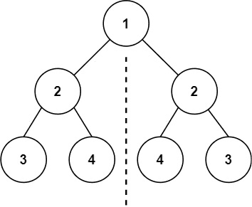
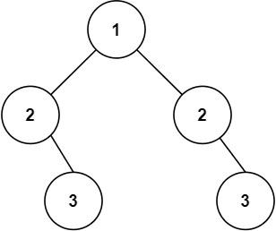

# 101. 对称二叉树

| 难度 | 专题 | 状态 | 优先级 | 力扣 |
| --- | --- | --- | --- | --- |
| 简单 | 二叉树 | 🔄 曾通过 | 复习 | [原题链接](https://leetcode.cn/problems/symmetric-tree) |

## 题目描述

给你一个二叉树的根节点 <code>root</code> ， 检查它是否轴对称。

&nbsp;

<strong>示例 1：</strong>

<pre>
<strong>输入：</strong>root = [1,2,2,3,4,4,3]
<strong>输出：</strong>true
</pre>

<strong>示例 2：</strong>

<pre>
<strong>输入：</strong>root = [1,2,2,null,3,null,3]
<strong>输出：</strong>false
</pre>

&nbsp;

<strong>提示：</strong>

<ul>
	<li>树中节点数目在范围 <code>[1, 1000]</code> 内</li>
	<li><code>-100 &lt;= Node.val &lt;= 100</code></li>
</ul>

&nbsp;

<strong>进阶：</strong>你可以运用递归和迭代两种方法解决这个问题吗？

## 本地题解

- Java：[0101.对称二叉树.java](<../solutions/java/0101.对称二叉树.java>)

## 思路图解

- 本地：[0101.对称二叉树.html](<../illustrations/0101.对称二叉树.html>)（下载后用浏览器打开）
- 在线：https://claude.ai/artifact/DSyFMRHEybcnVH23dX2nWE
