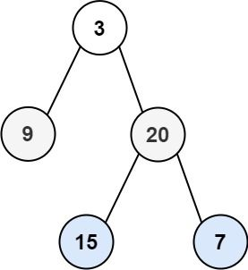

# 102. 二叉树的层序遍历

| 难度 | 专题 | 重要程度 | 力扣 |
| --- | --- | --- | --- |
| 中等 | 二叉树 | P0 | [原题链接](https://leetcode.cn/problems/binary-tree-level-order-traversal) |

## 题目描述

给你二叉树的根节点 <code>root</code> ，返回其节点值的 <strong>层序遍历</strong> 。 （即逐层地，从左到右访问所有节点）。

&nbsp;

<strong>示例 1：</strong>

<pre>
<strong>输入：</strong>root = [3,9,20,null,null,15,7]
<strong>输出：</strong>[[3],[9,20],[15,7]]
</pre>

<strong>示例 2：</strong>

<pre>
<strong>输入：</strong>root = [1]
<strong>输出：</strong>[[1]]
</pre>

<strong>示例 3：</strong>

<pre>
<strong>输入：</strong>root = []
<strong>输出：</strong>[]
</pre>

&nbsp;

<strong>提示：</strong>

<ul>
	<li>树中节点数目在范围 <code>[0, 2000]</code> 内</li>
	<li><code>-1000 &lt;= Node.val &lt;= 1000</code></li>
</ul>

## 思路图解

- 本地：[0102.二叉树的层序遍历.html](<../illustrations/0102.二叉树的层序遍历.html>)（下载后用浏览器打开）
- 在线：https://claude.ai/artifact/CGCKFGt9DTie36TxxTmtNA
- 网站：https://leetcode.cgent.link/p/102/（提示、动画演示、题解和我的提交都在一页）
