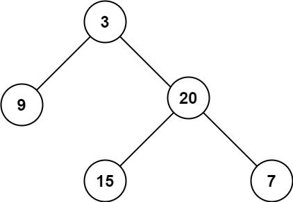

# 104. 二叉树的最大深度

| 难度 | 专题 | 重要程度 | 力扣 |
| --- | --- | --- | --- |
| 简单 | 二叉树 | P1 | [原题链接](https://leetcode.cn/problems/maximum-depth-of-binary-tree) |

## 题目描述

给定一个二叉树 <code>root</code> ，返回其最大深度。

二叉树的 <strong>最大深度</strong> 是指从根节点到最远叶子节点的最长路径上的节点数。

&nbsp;

<strong>示例 1：</strong>

&nbsp;

<pre>
<b>输入：</b>root = [3,9,20,null,null,15,7]
<b>输出：</b>3
</pre>

<strong>示例 2：</strong>

<pre>
<b>输入：</b>root = [1,null,2]
<b>输出：</b>2
</pre>

&nbsp;

<strong>提示：</strong>

<ul>
	<li>树中节点的数量在&nbsp;<code>[0, 104]</code>&nbsp;区间内。</li>
	<li><code>-100 &lt;= Node.val &lt;= 100</code></li>
</ul>

## 思路图解

- 本地：[0104.二叉树的最大深度.html](<../illustrations/0104.二叉树的最大深度.html>)（下载后用浏览器打开）
- 在线：https://claude.ai/artifact/YAj9dRhhgvgrAThiJ8ACbr
- 网站：https://leetcode.cgent.link/p/104/（提示、动画演示、题解和我的提交都在一页）
