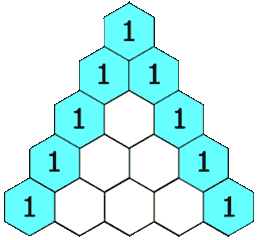

# 118. 杨辉三角

| 难度 | 专题 | 状态 | 优先级 | 力扣 |
| --- | --- | --- | --- | --- |
| 简单 | 动态规划 | ⬜ 未开始 | P2 | [原题链接](https://leetcode.cn/problems/pascals-triangle) |

## 题目描述

给定一个非负整数&nbsp;<code>numRows</code>。

返回「杨辉三角」的前&nbsp;<code>numRows</code>&nbsp;行。

在<strong>「杨辉三角」</strong>中，每个数是它左上方和右上方的数的和。

&nbsp;

<strong>示例 1:</strong>

<pre>
<strong>输入:</strong> numRows = 5
<strong>输出:</strong> [[1],[1,1],[1,2,1],[1,3,3,1],[1,4,6,4,1]]
</pre>

<strong>示例&nbsp;2:</strong>

<pre>
<strong>输入:</strong> numRows = 1
<strong>输出:</strong> [[1]]
</pre>

&nbsp;

<strong>提示:</strong>

<ul>
	<li><code>1 &lt;= numRows &lt;= 30</code></li>
</ul>

## 本地题解

暂无本地题解。

## 思路图解

- 本地：[0118.杨辉三角.html](<../illustrations/0118.杨辉三角.html>)（下载后用浏览器打开）
- 网站：https://leetcode.cgent.link/p/118/（提示、动画演示、题解和我的提交都在一页）
