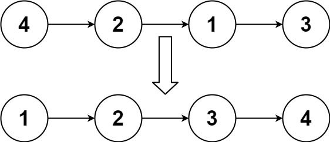
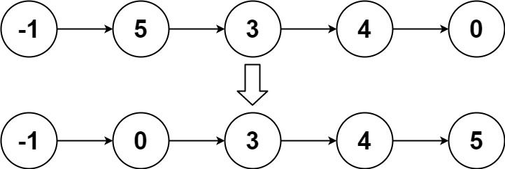

# 148. 排序链表

| 难度 | 专题 | 状态 | 优先级 | 力扣 |
| --- | --- | --- | --- | --- |
| 中等 | 链表 | ✅ 已通过 | 已通过 | [原题链接](https://leetcode.cn/problems/sort-list) |

## 题目描述

给你链表的头结点&nbsp;<code>head</code>&nbsp;，请将其按 <strong>升序</strong> 排列并返回 <strong>排序后的链表</strong> 。

<ul>
</ul>

&nbsp;

<strong>示例 1：</strong>

<pre>
<b>输入：</b>head = [4,2,1,3]
<b>输出：</b>[1,2,3,4]
</pre>

<strong>示例 2：</strong>

<pre>
<b>输入：</b>head = [-1,5,3,4,0]
<b>输出：</b>[-1,0,3,4,5]
</pre>

<strong>示例 3：</strong>

<pre>
<b>输入：</b>head = []
<b>输出：</b>[]
</pre>

&nbsp;

<b>提示：</b>

<ul>
	<li>链表中节点的数目在范围&nbsp;<code>[0, 5 * 104]</code>&nbsp;内</li>
	<li><code>-105&nbsp;&lt;= Node.val &lt;= 105</code></li>
</ul>

&nbsp;

<b>进阶：</b>你可以在&nbsp;<code>O(n&nbsp;log&nbsp;n)</code> 时间复杂度和常数级空间复杂度下，对链表进行排序吗？

## 本地题解

- Java：[0148.排序链表.java](<../solutions/java/0148.排序链表.java>)

## 思路图解

- 本地：[0148.排序链表.html](<../illustrations/0148.排序链表.html>)（下载后用浏览器打开）
- 在线：https://claude.ai/artifact/YFvZ2fHkRWQgBXbbi9KYot
- 网站：https://leetcode.cgent.link/p/148/（提示、动画演示、题解和我的提交都在一页）
