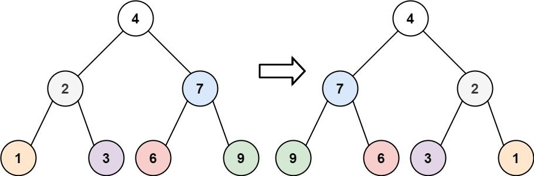
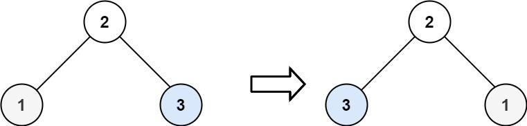

# 226. 翻转二叉树

| 难度 | 专题 | 状态 | 优先级 | 力扣 |
| --- | --- | --- | --- | --- |
| 简单 | 二叉树 | 🔄 曾通过 | 复习 | [原题链接](https://leetcode.cn/problems/invert-binary-tree) |

## 题目描述

给你一棵二叉树的根节点 <code>root</code> ，翻转这棵二叉树，并返回其根节点。

&nbsp;

<strong>示例 1：</strong>

<pre>
<strong>输入：</strong>root = [4,2,7,1,3,6,9]
<strong>输出：</strong>[4,7,2,9,6,3,1]
</pre>

<strong>示例 2：</strong>

<pre>
<strong>输入：</strong>root = [2,1,3]
<strong>输出：</strong>[2,3,1]
</pre>

<strong>示例 3：</strong>

<pre>
<strong>输入：</strong>root = []
<strong>输出：</strong>[]
</pre>

&nbsp;

<strong>提示：</strong>

<ul>
	<li>树中节点数目范围在 <code>[0, 100]</code> 内</li>
	<li><code>-100 &lt;= Node.val &lt;= 100</code></li>
</ul>

## 本地题解

- Java：[0226.翻转二叉树.java](<../solutions/java/0226.翻转二叉树.java>)

## 思路图解

- 本地：[0226.翻转二叉树.html](<../illustrations/0226.翻转二叉树.html>)（下载后用浏览器打开）
- 在线：https://claude.ai/artifact/7XCv28JzhNnxtHrkD3o7Bx
