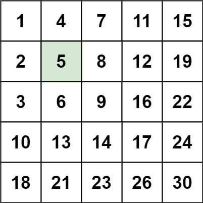
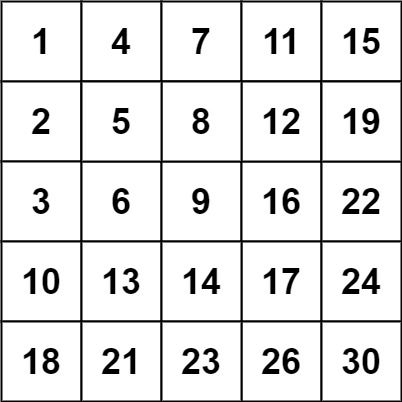

# 240. 搜索二维矩阵 II

| 难度 | 专题 | 状态 | 优先级 | 力扣 |
| --- | --- | --- | --- | --- |
| 中等 | 矩阵 | 🔄 曾通过 | 复习 | [原题链接](https://leetcode.cn/problems/search-a-2d-matrix-ii) |

## 题目描述

编写一个高效的算法来搜索&nbsp;<code><em>m</em>&nbsp;x&nbsp;<em>n</em></code>&nbsp;矩阵 <code>matrix</code> 中的一个目标值 <code>target</code> 。该矩阵具有以下特性：

<ul>
	<li>每行的元素从左到右升序排列。</li>
	<li>每列的元素从上到下升序排列。</li>
</ul>

&nbsp;

<b>示例 1：</b>

<pre>
<b>输入：</b>matrix = [[1,4,7,11,15],[2,5,8,12,19],[3,6,9,16,22],[10,13,14,17,24],[18,21,23,26,30]], target = 5
<b>输出：</b>true
</pre>

<b>示例 2：</b>

<pre>
<b>输入：</b>matrix = [[1,4,7,11,15],[2,5,8,12,19],[3,6,9,16,22],[10,13,14,17,24],[18,21,23,26,30]], target = 20
<b>输出：</b>false
</pre>

&nbsp;

<strong>提示：</strong>

<ul>
	<li><code>m == matrix.length</code></li>
	<li><code>n == matrix[i].length</code></li>
	<li><code>1 &lt;= n, m &lt;= 300</code></li>
	<li><code>-109&nbsp;&lt;= matrix[i][j] &lt;= 109</code></li>
	<li>每行的所有元素从左到右升序排列</li>
	<li>每列的所有元素从上到下升序排列</li>
	<li><code>-109&nbsp;&lt;= target &lt;= 109</code></li>
</ul>

## 本地题解

- Java：[0240.搜索二维矩阵 II.java](<../solutions/java/0240.搜索二维矩阵 II.java>)

## 思路图解

- 本地：[0240.搜索二维矩阵 II.html](<../illustrations/0240.搜索二维矩阵 II.html>)（下载后用浏览器打开）
- 在线：https://claude.ai/artifact/UQdtssXEEAd4bew9L3VMnd
- 网站：https://leetcode.cgent.link/p/240/（提示、动画演示、题解和我的提交都在一页）
