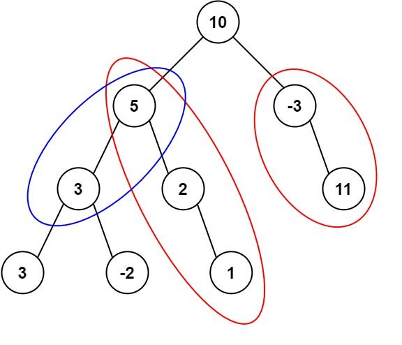

# 437. 路径总和 III

| 难度 | 专题 | 状态 | 优先级 | 力扣 |
| --- | --- | --- | --- | --- |
| 中等 | 二叉树 | ⬜ 未开始 | P2 | [原题链接](https://leetcode.cn/problems/path-sum-iii) |

## 题目描述

给定一个二叉树的根节点 <code>root</code> ，和一个整数 <code>targetSum</code> ，求该二叉树里节点值之和等于 <code>targetSum</code> 的 <strong>路径</strong> 的数目。

<strong>路径</strong> 不需要从根节点开始，也不需要在叶子节点结束，但是路径方向必须是向下的（只能从父节点到子节点）。

 

<strong>示例 1：</strong>

<pre>
<strong>输入：</strong>root = [10,5,-3,3,2,null,11,3,-2,null,1], targetSum = 8
<strong>输出：</strong>3
<strong>解释：</strong>和等于 8 的路径有 3 条，如图所示。
</pre>

<strong>示例 2：</strong>

<pre>
<strong>输入：</strong>root = [5,4,8,11,null,13,4,7,2,null,null,5,1], targetSum = 22
<strong>输出：</strong>3
</pre>

 

<strong>提示:</strong>

<ul>
	<li>二叉树的节点个数的范围是 <code>[0,1000]</code></li>
	<li><meta charset="UTF-8" /><code>-109 <= Node.val <= 109</code> </li>
	<li><code>-1000 <= targetSum <= 1000</code> </li>
</ul>

## 本地题解

暂无本地题解。

## 思路图解

- 本地：[0437.路径总和 III.html](<../illustrations/0437.路径总和 III.html>)（下载后用浏览器打开）
- 网站：https://leetcode.cgent.link/p/437/（提示、动画演示、题解和我的提交都在一页）
