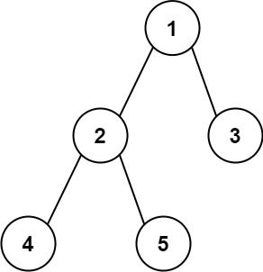

# 543. 二叉树的直径

| 难度 | 专题 | 状态 | 优先级 | 力扣 |
| --- | --- | --- | --- | --- |
| 简单 | 二叉树 | 🔄 曾通过 | 复习 | [原题链接](https://leetcode.cn/problems/diameter-of-binary-tree) |

## 题目描述

给你一棵二叉树的根节点，返回该树的 <strong>直径</strong> 。

二叉树的 <strong>直径</strong> 是指树中任意两个节点之间最长路径的 <strong>长度</strong> 。这条路径可能经过也可能不经过根节点 <code>root</code> 。

两节点之间路径的 <strong>长度</strong> 由它们之间边数表示。

&nbsp;

<strong class="example">示例 1：</strong>

<pre>
<strong>输入：</strong>root = [1,2,3,4,5]
<strong>输出：</strong>3
<strong>解释：</strong>3 ，取路径 [4,2,1,3] 或 [5,2,1,3] 的长度。
</pre>

<strong class="example">示例 2：</strong>

<pre>
<strong>输入：</strong>root = [1,2]
<strong>输出：</strong>1
</pre>

&nbsp;

<strong>提示：</strong>

<ul>
	<li>树中节点数目在范围 <code>[1, 104]</code> 内</li>
	<li><code>-100 &lt;= Node.val &lt;= 100</code></li>
</ul>

## 本地题解

- Java：[0543.二叉树的直径.java](<../solutions/java/0543.二叉树的直径.java>)

## 思路图解

- 本地：[0543.二叉树的直径.html](<../illustrations/0543.二叉树的直径.html>)（下载后用浏览器打开）
- 在线：https://claude.ai/artifact/8UKynPG6dkKQNLdMvxDyjs
